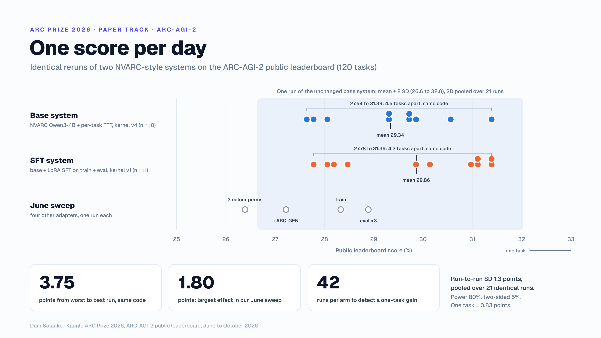

# ARC Prize 2026: one score per day

[](https://github.com/damsolanke/arc-prize-2026/actions/workflows/ci.yml)

Code, run records and statistics behind our ARC Prize 2026 entry: an NVARC-style system on the ARC-AGI-2 Kaggle leaderboard, and the Paper Track paper "One score per day: rerun noise and contaminated dev checks in an NVARC-style ARC-AGI-2 system".

**Result.** Our best public score is 31.39, reached by three runs of unchanged kernels on 3, 8 and 20 October 2026. On 3 October that placed 376th of 2,377 teams, 51.67 points behind the leader (83.06) and 8.19 points short of eighth place, the last paid one. By 26 October other teams had moved past us, and the same score ranked 603rd of 3,390. We claim no new solver. Private scores arrive after the competition closes on 2 November 2026.

<p align="center"></p>

## What the paper finds

In June we ranked six configurations by one leaderboard run each. Identical reruns in October showed that this ranking was unreliable.

| System | Kaggle notebook version | Runs | Mean ± SD | Range |
|---|---|---:|---:|---:|
| Base | `arc-agi-2-nvarc-4b-l4x4` v4 | 10 | 29.34 ± 1.21 | 27.64 to 31.39 |
| SFT (submitted) | `arc-agi-2-sft-infer-v3` v1 | 11 | 29.86 ± 1.46 | 27.78 to 31.39 |

- A single run varies with a pooled SD of 1.35 points (19 degrees of freedom), about 1.6 of the 120 public tasks. Ten runs of the unchanged base kernel spanned 3.75 points, against 1.80 for the largest effect in the June fine-tuning sweep.
- SFT leads base by 0.53 points (95% CI -0.71 to +1.76), so there is no evidence that our fine-tuning helped.
- Our 16-task dev check could not stand in for the leaderboard. NVARC generated part of the base checkpoint's training data from summaries of all 120 public evaluation tasks, and three of our adapters trained on those tasks directly.
- At one submission per day, telling a one-task gain from noise takes about 42 runs per system: 84 days.

Earlier entries scored 0.00 (three heuristic-ensemble submissions in April) and 10.42 (T4 settings on 2 x T4 GPUs, June).

## System

| Stage | Setting |
|---|---|
| Base checkpoint | `sorokin/qwen3_4b_grids15_sft139`, NVARC's Qwen3-4B with a 16-token grid vocabulary |
| Our SFT (SFT system only) | LoRA r 256, alpha 32, one epoch on the 1,000 training and 120 evaluation tasks with solutions, merged into the base |
| Per-task test-time training | Fresh LoRA, one epoch on 128 augmented copies of the task |
| Decoding | Depth-first search over 16 views; candidates ranked by decode count minus mean NLL under 8 re-encoded views |
| Budget | One worker per GPU on 4 x L4, 1,200 s per task, 12 h minus 600 s in total |

The base notebook is kaiserm's public 2026 port of NVARC's Kaggle notebook with three small edits (model path search, a guard in the dev-mode printout, a 16-task dev sample). For the SFT system, the inference notebook adds a 16-line block that merges our adapter before test-time training.

## Reproduce

Paper statistics and the cover image need Python 3.11 or newer and no data download:

```bash
git clone https://github.com/damsolanke/arc-prize-2026
cd arc-prize-2026
python3 -m venv .venv && source .venv/bin/activate
pip install -e ".[dev]"
python paper/make_figures.py
```

`make_figures.py` reads `paper/evidence/`, prints every derived number in the paper and redraws `paper/figures/cover.svg`. With `rsvg-convert` installed it also writes `cover.png`. It reproduces the committed SVG exactly from the data in this repository.

Leaderboard runs need a Kaggle account with GPU quota. Each `kernel-metadata.json` names the owner `YOUR_KAGGLE_USERNAME`, and `scripts/sdk_kaggle.py` fills in the account from `~/.kaggle/kaggle.json`:

```bash
pip install kagglesdk
python scripts/sdk_kaggle.py push kaggle_kernel/arc_agi2_sft_v3          # trains the SFT adapter, about 2.5 h
python scripts/sdk_kaggle.py push kaggle_kernel/arc_agi2_sft_infer_v3    # dev mode on 16 evaluation tasks
python scripts/sdk_kaggle.py submit arc-agi-2-sft-infer-v3 1 "rerun"     # one submission per UTC day
```

The submitted SFT system is the Kaggle notebook [arc-agi-2-sft-infer-v3, version 1](https://www.kaggle.com/code/adesolanke/arc-agi-2-sft-infer-v3?scriptVersionId=328952350), with its adapter from [arc-agi-2-sft-4b-v3, version 1](https://www.kaggle.com/code/adesolanke/arc-agi-2-sft-4b-v3). Kaggle keeps notebooks attached to a running competition private, so both become public when the competition closes on 2 November 2026; until then their code is in `kaggle_kernel/arc_agi2_sft_infer_v3` and `kaggle_kernel/arc_agi2_sft_v3` here. [`paper/reproduce.md`](paper/reproduce.md) maps every number in the paper to a data file, a command or a kernel version.

Our heuristic solvers in `src/` run on the public ARC-AGI-2 tasks:

```bash
git clone --depth=1 https://github.com/arcprize/arc-agi-2 reference/arc-agi-v2
make test        # 54 tests
make baseline    # 12 solver configurations on 120 evaluation and 1,000 training tasks, about 80 s
```

Every configuration solves 0 of the 120 evaluation tasks. A verified ensemble does best on the training set, with 64 of 1,000.

## Project structure

```
arc-prize-2026/
  kaggle_kernel/
    arc_agi2_nvarc_l4x4/                        base system, submitted as version 4
    arc_agi2_sft{,_v2,_v3,_syn,_evup}/          SFT training notebooks (June sweep)
    arc_agi2_sft_infer{,_v2,_v3,_syn,_evup}/    SFT inference notebooks; _v3 is the SFT system
    arc_prize_2026_baseline.py                  heuristic ensemble kernel (April)
  paper/
    evidence/        all ARC-AGI-2 submissions, dev runs, 3 October leaderboard without names
    figures/         cover.svg, cover.png
    make_figures.py  statistics and cover image
    reproduce.md     paper numbers to files, commands and kernels
  scripts/           heuristic analysis scripts, sdk_kaggle.py
  src/               heuristic solvers (60 modules), loaders, scorer
  tests/
  LICENSE            MIT-0
  LICENSES/          Apache-2.0.txt
  NOTICE             credits and licence scope
```

## Testing

```bash
pytest -q tests/           # 54 tests; the data test skips unless reference/arc-agi-v2 exists
ruff check src/ tests/
```

CI (`.github/workflows/ci.yml`) clones the public ARC-AGI-2 tasks, runs ruff and pytest, then the heuristic baseline.

## Credits

- **NVARC** (Ivan Sorokin and Jean-François Puget), winners of ARC Prize 2025: the Qwen3-4B checkpoint, the Kaggle notebook our kernels run (per-task test-time training, the four-GPU worker queue, the kgmon scorer) and the package notebook it installs from.
- **The ARChitects** (Daniel Franzen and Jan Disselhoff): the ARC Prize 2024 code that NVARC's notebook builds on (data loader, augmentations, depth-first search decoding, candidate selection). Their copyright notice is kept in `NOTICE` and at the top of every notebook.
- **kaiserm**: the public 2026 port of NVARC's notebook that our kernels fork.
- **ARC-GEN** (Michael D. Moffitt, arXiv:2511.00162): the synthetic tasks behind one June adapter (`arc_agi2_sft_syn`).
- **Qwen3-4B** (Qwen team), the base model of NVARC's checkpoint.

## Licence

Code written for this project is released under MIT-0 ([LICENSE](LICENSE)): `src/`, `tests/`, `scripts/`, `paper/make_figures.py`, `kaggle_kernel/arc_prize_2026_baseline.py`, and our changes to the notebooks in `kaggle_kernel/`, which a notice cell at the top of each notebook lists. Everything else in those notebooks comes from NVARC's Kaggle notebook, which NVARC released on Kaggle under Apache 2.0, and from the ARChitects' 2024 code (Copyright 2024 Daniel Franzen and Jan Disselhoff, Apache License 2.0). Those parts stay under Apache 2.0; see [NOTICE](NOTICE) and [LICENSES/Apache-2.0.txt](LICENSES/Apache-2.0.txt). That cell is the only addition to the notebooks, and it changes no code.

Neither the model `sorokin/qwen3_4b_grids15_sft139` (Apache 2.0) nor the ARC-AGI-2 competition data is included. NVARC's GitHub repository has no licence, so nothing from it is copied here. On Kaggle, the paper is a Paper Track writeup under CC BY 4.0.
